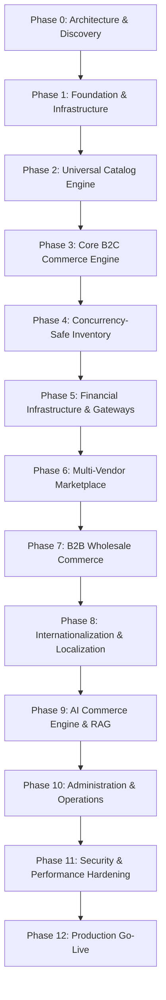
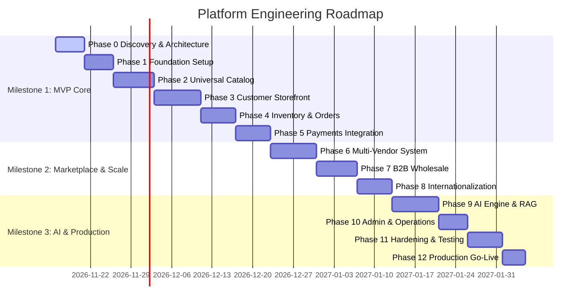

# Master Engineering Execution Plan
## Universal AI-Powered Global Commerce & Marketplace Platform

---

### Executive Summary

This document establishes the **end-to-end engineering execution blueprint** for the Universal AI-Powered Global Commerce & Marketplace Platform. Designed under senior software engineering and principal architecture standards, this platform transitions from a robust foundational core into a high-scale modular commerce ecosystem supporting B2C, B2B wholesale, multi-vendor marketplace, and dynamic AI-assisted workflows.

---

## 1. Project Phase & Task Breakdown

### Phase 0: Discovery, Architecture & MVP Scope Definition
> **Objective:** Establish foundational system design, architectural decision records (ADRs), database entity relationships, and strict MVP boundaries before writing production code.

*   **T0.1: Multi-Tenant & Domain Modeling**
    *   Define core domain boundaries (Catalog, Inventory, Orders, Payments, Users, Sellers, B2B).
    *   Establish separation of tenant/seller data models to ensure strict data isolation.
*   **T0.2: Universal Product Model & Dynamic Attribute Design**
    *   Formulate the Hybrid relational + JSONB schema for dynamic category attributes (flexible alternative to traditional EAV).
    *   Standardize unit of measurement (UoM), variant matrices, and validation rules.
*   **T0.3: Technology Stack & API Architecture Specification**
    *   Finalize Medusa.js 2.x headless commerce framework integration points.
    *   Define Next.js 15 (App Router) frontend server/client boundary patterns.
    *   Define REST / GraphQL / Event-driven contract strategy (OpenAPI 3.1).
*   **T0.4: Database ERD & Transactional Boundaries**
    *   Design schema for PostgreSQL with `pgvector` extension for semantic embeddings.
    *   Define foreign key constraints, indexes, and transactional outbox patterns.
*   **T0.5: Security Architecture & Threat Modeling**
    *   Define Role-Based Access Control (RBAC) hierarchy.
    *   Design token-based auth (JWT + refresh tokens with secure HTTP-only cookies).
    *   Payment data compliance & PCI DSS scope minimization strategy.
*   **T0.6: MVP Scope Agreement & Delivery Milestone Plan**
    *   Formalize Phase 1 to Phase 5 as the core MVP launch path.
*   **Gate / Definition of Done (DoD):** ADRs approved, complete ERD generated, API specs drafted, MVP scope locked.

---

### Phase 1: Foundation & Core Infrastructure
> **Objective:** Establish reproducible containerized environments, monorepo configuration, CI/CD pipelines, and health-checked foundations.

*   **T1.1: Monorepo Architecture Setup**
    *   Configure Turborepo with pnpm workspaces.
    *   Packages: `@platform/ui`, `@platform/types`, `@platform/config`, `@platform/sdk`.
    *   Apps: `web` (Next.js Storefront), `backend` (Medusa.js Commerce Engine), `admin` (Admin/Seller Portal).
*   **T1.2: Local Infrastructure Provisioning (Docker Compose)**
    *   PostgreSQL 16 container with `pgvector` enabled.
    *   Redis 7 container for caching and message queuing.
    *   MinIO container for S3-compatible local asset storage.
*   **T1.3: Commerce Backend Initialization (Medusa.js)**
    *   Initialize backend service with TypeScript strict mode.
    *   Configure database connection pooling and base migration runner.
    *   Implement `/health` and `/ready` probes.
*   **T1.4: Storefront Foundation (Next.js 15 App Router)**
    *   Set up Tailwind CSS, Radix UI primitives, Lucide icons, and responsive layouts.
    *   Implement theme provider, font optimization, and global state management (Zustand).
*   **T1.5: CI/CD Pipeline & Code Quality Tooling**
    *   Configure GitHub Actions for automated linting (ESLint), formatting (Prettier), type checking (`tsc --noEmit`), and Vitest test runner.
*   **Gate / Definition of Done (DoD):** All containers spin up via a single command, both Next.js and Medusa start without errors, and CI passes 100%.

---

### Phase 2: Universal Product Catalog & Dynamic Attribute Engine
> **Objective:** Build a catalog engine supporting any arbitrary category (fashion, grocery, agriculture, tech, industrial) without database schema changes.

*   **T2.1: Dynamic Attribute & Category Entity Layer**
    *   Create migrations for `categories`, `attributes`, and `category_attributes`.
    *   Support attribute types: `TEXT`, `NUMBER`, `SELECT`, `MULTI_SELECT`, `BOOLEAN`, `DATE`, `RANGE`.
*   **T2.2: Universal Product Model Implementation**
    *   Create `products`, `product_variants`, `product_attributes_values`, and `product_media`.
    *   Implement SKU generation logic, barcode mapping, and physical/digital product types.
*   **T2.3: Category-Specific Validation Engine**
    *   Build schema validation service (Zod-based) that validates product input against its category attributes.
*   **T2.4: Product Lifecycle & Moderation State Machine**
    *   Statuses: `DRAFT` ➔ `PENDING_REVIEW` ➔ `PUBLISHED` ➔ `UNPUBLISHED` ➔ `ARCHIVED`.
    *   Implement state transitions with role authorization.
*   **T2.5: Search Indexing Pipeline Foundation**
    *   Implement PostgreSQL Full-Text Search (tsvector + GIN indexes) across title, description, and dynamic attributes.
*   **Gate / Definition of Done (DoD):** Ability to create, validate, and query distinct products (e.g. Shoes with sizes/colors vs. Fertilizer with NPK ratio/weight) through identical APIs.

---

### Phase 3: Customer Experience & Core B2C Commerce Storefront
> **Objective:** Deliver a responsive, high-performance storefront with end-to-end shopping journey.

*   **T3.1: Customer Authentication & Profile Management**
    *   Registration, email verification, password reset, login with JWT / session cookies.
    *   Customer profile with multiple shipping & billing address books.
*   **T3.2: Modern Storefront Navigation & Discovery**
    *   Mega-menu, category hierarchical drill-down, dynamic faceted filtering (brand, price, dynamic attributes).
*   **T3.3: Product Detail Page (PDP) Architecture**
    *   Server-rendered PDP with image gallery, zoom, variant selector matrix, stock availability badge, and specifications table.
*   **T3.4: Cart Management Engine**
    *   Persistent cart across guest and authenticated sessions (session merge on login).
    *   Line item price calculations, discount code validation, and cart expiration rules.
*   **T3.5: Multi-Step Checkout Flow**
    *   Step 1: Address selection & shipping method calculation.
    *   Step 2: Tax calculation based on jurisdiction.
    *   Step 3: Payment method selection.
    *   Step 4: Order review and confirmation screen.
*   **Gate / Definition of Done (DoD):** A customer can discover a product, filter by attributes, add to cart, and reach the payment step without client-side errors.

---

### Phase 4: Concurrency-Safe Inventory & Order Lifecycle
> **Objective:** Prevent overselling under high concurrency and maintain an auditable order pipeline.

*   **T4.1: Multi-Location Warehouse & Inventory Model**
    *   Entities: `warehouses`, `inventory_items`, `inventory_levels`, `stock_reservations`.
*   **T4.2: Concurrency-Safe Stock Reservation Engine**
    *   Implement 2-phase stock reservation using PostgreSQL row-level locking (`SELECT ... FOR UPDATE`) or Redis distributed locks.
    *   Auto-release reservation on checkout timeout (TTL-based expiration worker).
*   **T4.3: Order State Machine & Event Ledger**
    *   Statuses: `PENDING` ➔ `PAID` ➔ `PROCESSING` ➔ `SHIPPED` ➔ `DELIVERED` / `CANCELLED`.
    *   Immutable audit trail for every status change (`order_events`).
*   **T4.4: Returns & Refunds (RMA) Engine**
    *   Customer return request creation, eligibility validation, admin/seller inspection status, refund authorization.
*   **Gate / Definition of Done (DoD):** Automated concurrency test simulates 100 simultaneous checkouts on a single remaining inventory item; exactly 1 succeeds, 99 fail gracefully.

---

### Phase 5: Financial Infrastructure & Payment Gateway Adapters
> **Objective:** Implement a provider-agnostic payment abstraction with Pakistan and global gateway support.

*   **T5.1: Payment Provider Interface & Abstraction Layer**
    *   Interface: `authorize()`, `capture()`, `refund()`, `handleWebhook()`, `verifySignature()`.
    *   Idempotency enforcement via unique transaction keys.
*   **T5.2: Pakistan Local Gateway Adapter**
    *   Integration with JazzCash / Easypaisa Sandbox (Direct API / Hosted checkout).
    *   Secure callback verification and merchant settlement reconciliation.
*   **T5.3: International Gateway Adapter**
    *   Stripe Payment Intents integration (Credit/Debit Card, 3D Secure, Apple Pay, Google Pay).
*   **T5.4: Payment Webhook Security & Idempotency**
    *   HMAC signature verification on incoming webhooks.
    *   Replay attack defense using unique webhook ID caching in Redis.
*   **T5.5: Cash on Delivery (COD) Workflow**
    *   Configurable COD rules with verification thresholds and delivery confirmation steps.
*   **Gate / Definition of Done (DoD):** Test orders successfully processed, captured, and refunded via both Stripe and Pakistani sandboxes with verified ledger entries.

---

### Phase 6: Multi-Vendor Marketplace & Seller Subsystem
> **Objective:** Enable independent sellers to onboard, manage catalog/orders, and receive automated commission-based payouts.

*   **T6.1: Seller Onboarding & KYC Workflow**
    *   Seller business registration, tax documents, bank payout details, and admin approval pipeline.
*   **T6.2: Tenant Data Isolation & Seller RBAC**
    *   Enforce tenant-level query filtering in backend modules (sellers can only view their own products, orders, and revenues).
*   **T6.3: Multi-Seller Order Splitting Engine**
    *   Parent Order ➔ Child Orders (1 Sub-Order per unique seller).
    *   Independent shipping costs, separate fulfillment statuses, and isolated tracking numbers.
*   **T6.4: Marketplace Commission & Payout Ledger**
    *   Configurable commission: Flat %, Category-based %, or Seller-specific tier.
    *   Automated calculation of Net Payable to seller and platform commission.
*   **T6.5: Dedicated Seller Dashboard**
    *   Product creation UI, inventory management, sub-order fulfillment panel, and earnings report.
*   **Gate / Definition of Done (DoD):** A single customer order with items from 2 distinct sellers correctly splits into 2 sub-orders; each seller only sees and fulfills their own items.

---

### Phase 7: B2B Wholesale Commerce
> **Objective:** Support high-volume corporate and commercial purchasing with negotiated pricing and credit terms.

*   **T7.1: Company Accounts & Organizational Hierarchy**
    *   Company profile, tax registration (NTN/GST/VAT), multiple employee users with role assignments (Purchaser, Approver, Admin).
*   **T7.2: Wholesale Pricing & Volume Tiers**
    *   Tiered quantity pricing (e.g. 1-99 units: \$10, 100-499: \$8, 500+: \$6).
    *   Minimum Order Quantity (MOQ) enforcement per product variant.
*   **T7.3: Request for Quotation (RFQ) & Negotiation Flow**
    *   Buyer submits RFQ ➔ Seller/Admin responds with custom quote ➔ Buyer approves quote ➔ Converts to order.
*   **T7.4: B2B Payment Terms & Credit Management**
    *   Support for Net 15, Net 30, and Net 60 payment terms.
    *   Company credit limits, outstanding balance tracking, and auto-hold on overdue accounts.
*   **Gate / Definition of Done (DoD):** An approved B2B company account accesses wholesale pricing and completes an RFQ-to-order flow with Net 30 payment terms.

---

### Phase 8: International Commerce & Multi-Region Localization
> **Objective:** Enable multi-country routing, multi-currency pricing, and multi-language layouts (including RTL).

*   **T8.1: Multi-Currency Engine & Exchange Rates**
    *   Supported currencies: PKR, USD, AED, SAR, GBP, EUR.
    *   Integration with daily FX rate feed; historical exchange rate locking on confirmed orders.
*   **T8.2: Localization & RTL Support (Next.js i18n)**
    *   Full translation support for English, Urdu, and Arabic.
    *   Bidirectional layout switching (LTR / RTL) with Tailwind CSS logical properties.
*   **T8.3: Regional Tax & Compliance Engine**
    *   Configurable tax rates (e.g., Pakistan GST, UAE/KSA VAT, US Sales Tax).
    *   Generation of compliant tax invoices with regional requirements.
*   **T8.4: International Shipping & Customs Automation**
    *   Shipping zone configuration, carrier integration hooks (TCS/Leopards in PK, DHL/FedEx internationally).
    *   Harmonized System (HS) codes and customs invoice generation.
*   **Gate / Definition of Done (DoD):** User can switch between Pakistan (PKR, Urdu/English, GST) and UAE (AED, Arabic, VAT) with correct currencies, prices, and layouts.

---

### Phase 9: AI Commerce Engine (RAG, Semantic Search & Assistant)
> **Objective:** Integrate contextual AI intelligence into search, recommendations, and customer support.

*   **T9.1: Embedding Generation Pipeline**
    *   Generate vector embeddings for all published products using `text-embedding-3-small` or Gemini embeddings.
    *   Store and index vectors in PostgreSQL using `pgvector` with HNSW indexing.
*   **T9.2: Hybrid Semantic Search Engine**
    *   Combine full-text search (BM25/FTS) with vector similarity (Cosine Distance) using Reciprocal Rank Fusion (RRF).
*   **T9.3: Multilingual AI Shopping Assistant**
    *   RAG pipeline capable of parsing queries like *"Mujhe 5000 PKR ke andar achay running shoes dikhao"* or *"Compare these two laptops"*.
    *   Assistant interacts strictly with real database records via function-calling / tool-use.
*   **T9.4: AI Customer Support & Policy RAG**
    *   Ground assistant responses in verified store policies (Return, Shipping, Warranty) with human escalation fallback.
*   **T9.5: AI Guardrails, Security & Cost Observability**
    *   Rate limiting per user session, prompt injection sanitization, token consumption telemetry, and model provider abstraction.
*   **Gate / Definition of Done (DoD):** AI assistant answers product and policy queries accurately using live DB data without hallucinations or unauthorized disclosures.

---

### Phase 10: Central Administration, Operations & Marketing
> **Objective:** Deliver the operational nerve center for platform administrators.

*   **T10.1: Super Admin Executive Dashboard**
    *   Real-time and batch metrics: Gross Merchandise Value (GMV), net revenue, active sellers, order conversion rates.
*   **T10.2: Content & Dynamic Banner Management (CMS)**
    *   Manage hero sliders, promotional banners, featured category rails, and announcement bars.
*   **T10.3: Marketing & Promotions Engine**
    *   Coupon codes, automatic cart discounts, flash sales with start/end timers, and bundle discounts.
*   **T10.4: Search Engine Optimization (SEO) Automation**
    *   Dynamic Open Graph images, canonical tags, automated XML sitemaps, and Schema.org Product/Offer JSON-LD structured data.
*   **Gate / Definition of Done (DoD):** Admin can modify site configuration, audit transactions, and create marketing campaigns without technical team intervention.

---

### Phase 11: Security, Reliability & Performance Hardening
> **Objective:** Subject the complete platform to rigorous security penetration tests and stress testing.

*   **T11.1: Automated Test Suite Completion**
    *   Unit test coverage > 85% for business logic (Pricing, Tax, Inventory, Commissions).
    *   Integration test coverage for all API endpoints.
    *   Playwright E2E suites covering critical buyer, seller, and admin journeys.
*   **T11.2: Concurrency & Stress Testing (k6)**
    *   Simulate high-traffic flash sales (target: storefront p95 < 500ms, API p95 < 300ms).
*   **T11.3: Security Penetration & Vulnerability Audit**
    *   OWASP Top 10 audit, SQL injection verification, XSS filters, CSRF protection, and dependency vulnerability scan (`npm audit`).
*   **T11.4: Disaster Recovery & Backup Drills**
    *   Automated daily PostgreSQL and Redis snapshot verification; test restoration in staging.
*   **Gate / Definition of Done (DoD):** Zero critical/high vulnerabilities, all E2E tests passing, and performance benchmarks verified in a staging environment.

---

### Phase 12: Production Go-Live & Operational Readiness
> **Objective:** Seamless, zero-downtime deployment to production infrastructure with 24/7 telemetry.

*   **T12.1: Production Cloud Infrastructure Provisioning**
    *   Managed PostgreSQL with read replicas and pgvector.
    *   Managed Redis cluster for cache and queues.
    *   S3/Cloudflare R2 object storage with global Cloudflare CDN.
*   **T12.2: Live Payment & Carrier Gateway Certification**
    *   Switch gateway keys from sandbox to production merchant accounts.
*   **T12.3: Telemetry, Logging & Alerting Setup**
    *   Application performance monitoring (APM), error tracking (Sentry), and uptime alerting (PagerDuty/Slack).
*   **T12.4: Phased Production Launch**
    *   Soft launch (internal staff / beta testers) ➔ Public launch.
*   **Gate / Definition of Done (DoD):** Production system running live transactions with healthy monitoring metrics and disaster recovery validated.

---

## 2. Summary of Phases & Task Counts

| Phase | Phase Name | Focus Area | Tasks | Priority |
|---|---|---|:---:|:---:|
| **0** | Discovery & Architecture | Design, ERD, ADRs, MVP Scope | 6 | **Mandatory First Step** |
| **1** | Foundation & Infrastructure | Turborepo, Next.js, Medusa, Docker | 5 | Phase 1 Foundation |
| **2** | Universal Product Catalog | Dynamic Attributes, EAV/JSONB, Search | 5 | Core MVP |
| **3** | Customer Commerce Storefront | Next.js Frontend, PDP, Cart, Checkout | 5 | Core MVP |
| **4** | Concurrency-Safe Inventory | Warehouses, Stock Locks, Order State | 4 | Core MVP |
| **5** | Financial Infrastructure | Payment Abstraction, JazzCash, Stripe | 5 | Core MVP |
| **6** | Multi-Vendor Marketplace | Seller Onboarding, Multi-vendor split | 5 | Expansion Phase |
| **7** | B2B Wholesale Commerce | Company Accounts, Tiers, RFQ, Net Terms| 4 | Expansion Phase |
| **8** | International Commerce | Multi-Currency, RTL, Regional Tax | 4 | Expansion Phase |
| **9** | AI Commerce Engine | RAG, Semantic Search, Assistant | 5 | Advanced Capability |
| **10** | Admin & Marketing | Super Admin, Promotions, SEO | 4 | Platform Operations |
| **11** | Hardening & Performance QA | k6 Load Testing, Security Audit | 4 | Pre-Launch |
| **12** | Production Go-Live | Cloud Infra, Monitoring, Launch | 4 | Launch |
| **Total**| **13 Phases** | **Complete Universal Ecosystem** | **60 Tasks** | |

---

## 3. Recommended Phased Rollout Strategy

To prevent over-engineering and ensure quick time-to-market, development will proceed in 3 Milestones:

---

## 4. Immediate Next Step: Phase 0 Kickoff

As specified in the prompt's rules, implementation begins strictly with **Phase 0**.
Before generating any architecture files or code, the following architectural decisions need mutual alignment:

1. **Backend Base:** Confirm **Medusa.js 2.x** with custom modules or a standalone custom **Node.js/FastAPI** service setup?
2. **First Target Market for MVP:** Launch with **Pakistan (PKR, JazzCash/Easypaisa/COD)** first, or immediately dual launch with **International (Stripe, USD)**?
3. **Primary Initial Categories:** Which 3 to 4 categories will serve as our primary validation data (e.g., Fashion + Tech + Grocery)?
