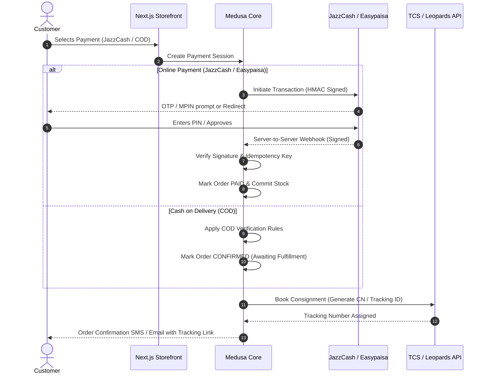

# Architecture Document 01: System Architecture & Integration Design
## Project: Universal AI-Powered Commerce Platform (Pakistan First -> Global)

---

### 1. Architectural Style: Modular Monolith

As established in the Master Blueprint, we adopt a **Modular Monolith** pattern. This avoids premature microservice overhead while enforcing strict module boundaries, clear domain interfaces, and transactional integrity.

```mermaid
graph TB
    subgraph Client Layer
        A1["Storefront Web App (Next.js 15 App Router)"]
        A2["Mobile Responsive Browsers (PWA Ready)"]
        A3["Admin & Seller Console (Vite / Next.js)"]
    end

    subgraph Edge & Gateway Layer
        B1["Cloudflare CDN / Edge Caching"]
        B2["API Gateway / Reverse Proxy (SSL, Rate-Limiting)"]
    end

    subgraph Core Commerce Engine (Medusa.js 2.x Modular Monolith)
        C1["Identity & Auth Module (JWT, RBAC)"]
        C2["Universal Catalog Module (Dynamic Attributes)"]
        C3["Pricing & Multi-Currency Engine (PKR First)"]
        C4["Concurrency-Safe Inventory Module"]
        C5["Cart & Checkout Engine"]
        C6["Order State Machine & Event Ledger"]
        C7["Payment Abstraction (JazzCash, Easypaisa, COD, Stripe)"]
        C8["Logistics & Fulfillment (TCS, Leopards, DHL)"]
        C9["Marketplace & Seller Isolation Engine"]
    end

    subgraph AI Intelligence Layer
        D1["AI Orchestrator (FastAPI / Node Service)"]
        D2["Vector Pipeline (pgvector HNSW)"]
        D3["LLM Provider Abstraction (Gemini / OpenAI)"]
    end

    subgraph Persistence & Infrastructure
        E1[("PostgreSQL 16 (Primary DB + pgvector)")]
        E2[("Redis 7 (Distributed Cache, BullMQ, Stock Locks)")]
        E3["Object Storage (S3 / MinIO / Cloudflare R2)"]
    end

    A1 --> B1
    A2 --> B1
    A3 --> B1
    B1 --> B2
    B2 --> Core Commerce Engine

    C2 --> D1
    D1 --> D2
    D2 --> E1
    D1 --> D3

    Core Commerce Engine --> E1
    Core Commerce Engine --> E2
    Core Commerce Engine --> E3
```

---

### 2. Frontend Layer: Next.js 15 (Storefront)

*   **Framework:** Next.js 15 with App Router (`app/` directory).
*   **Rendering Paradigm:**
    *   **Server Components (RSC):** Used by default for Product Listing Pages (PLP), Product Detail Pages (PDP), and Category landing pages for instant TTFB (Time to First Byte) and high SEO score.
    *   **Client Components (`'use client'`):** Restricted strictly to interactive leaves (Cart Drawer, Filter Dropdowns, Variant Selectors, Search Autocomplete).
*   **State Management:**
    *   Server state via React cache & Next.js tag-based revalidation (`revalidateTag`).
    *   Client state (Cart, User UI preferences) via **Zustand** with persistent local storage sync.
*   **Styling & Design System:** Tailwind CSS with Radix UI headless accessible primitives (Shadcn UI pattern).

---

### 3. Core Commerce Engine: Medusa.js 2.x Architecture

Medusa.js 2.x acts as the central commerce kernel. Rather than writing basic cart, auth, and order math from scratch, we build on top of Medusa's battle-tested workflows and extend it with custom modules:

1.  **Custom Universal Catalog Module:**
    *   Replaces standard flat product schemas with a dynamic category-attribute engine.
2.  **Custom Payment Module (Pakistan First):**
    *   Implements the `AbstractPaymentProvider` interface for **JazzCash (MWallet & Card)**, **Easypaisa (Mobile Account & Card)**, and verified **Cash on Delivery (COD)**.
    *   Pre-wired for **Stripe** activation during the international phase.
3.  **Concurrency-Safe Stock Module:**
    *   Uses 2-phase commit and Redis distributed locks for checkout reservations, preventing overselling in high-demand flash sales.

---

### 4. Database & Caching Strategy

| Service | Technology | Role & Configuration |
|---|---|---|
| **Primary Database** | PostgreSQL 16 | Relational data, ACID transactions, row-level locking, foreign key integrity |
| **Vector Engine** | `pgvector` extension | Stores 768/1536-dimensional embeddings for hybrid semantic search |
| **Distributed Cache** | Redis 7 | Response caching, session states, Redis Locks for inventory concurrency |
| **Background Queues** | BullMQ (via Redis) | Asynchronous webhook processing, email/SMS dispatch, embedding generation |
| **Object Storage** | S3 / MinIO / Cloudflare R2 | Product images, brand logos, seller KYC verification documents |

---

### 5. Pakistan-First Payment & Shipping Integration Boundaries



---

### 6. Architectural Decision Records (ADRs) Summary

*   **ADR-001 (Monolith vs Microservices):** Modular monolith chosen to eliminate network latency, complex cross-service transactions, and high deployment overhead during initial growth.
*   **ADR-002 (Catalog Schema):** Hybrid Relational + JSONB schema chosen over pure EAV (Entity-Attribute-Value). Relational tables govern Categories and Products; dynamic attributes are validated against category schemas and indexed via PostgreSQL JSONB GIN indexes.
*   **ADR-003 (Payment Abstraction):** Strict adapter pattern isolating gateway-specific APIs behind a universal interface (`authorize`, `capture`, `refund`, `verifyWebhook`).
