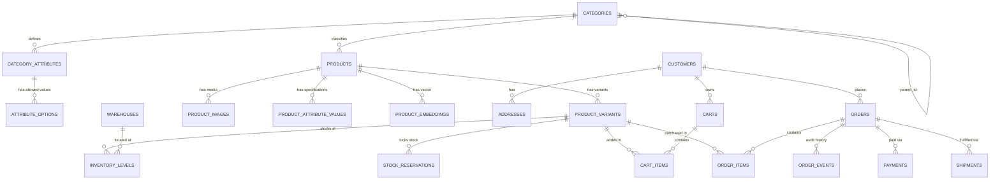

# Architecture Document 02: Universal Database ERD & Schema Design
## Relational + Dynamic JSONB Engine for PostgreSQL 16 & pgvector

---

### 1. Conceptual Model: The Universal Dynamic Attribute Engine

Traditional e-commerce platforms either have rigid columns (e.g., `size`, `color`) which fail when selling laptops or fertilizer, or they use messy EAV (Entity-Attribute-Value) anti-patterns that destroy SQL query performance.

We use an **Enterprise Hybrid Relational + JSONB Schema**:
1. **Core Relational Columns:** Fixed fields that *every* product has (`id`, `title`, `slug`, `sku`, `price`, `currency`, `status`, `category_id`).
2. **Category-Governed Dynamic Attributes (`category_attributes`):** Metadata that dictates which attributes belong to a category, their validation types (`SELECT`, `NUMBER`, `TEXT`, `BOOLEAN`), units of measurement, and whether they are filterable.
3. **Structured Attribute Values (`product_attribute_values` + JSONB indexing):** High-speed indexed attribute storage with GIN indexes, allowing instant sub-millisecond filtering across thousands of variants.



---

### 2. Core Schema Definition (PostgreSQL 16 DDL)

#### 2.1 Dynamic Categories & Attributes
```sql
-- Hierarchical Categories (e.g., Electronics -> Laptops; Fashion -> Men -> Shoes)
CREATE TABLE categories (
    id UUID PRIMARY KEY DEFAULT gen_random_uuid(),
    parent_id UUID REFERENCES categories(id) ON DELETE SET NULL,
    name VARCHAR(150) NOT NULL,
    slug VARCHAR(180) UNIQUE NOT NULL,
    description TEXT,
    icon_url TEXT,
    banner_url TEXT,
    is_active BOOLEAN DEFAULT TRUE,
    created_at TIMESTAMPTZ DEFAULT NOW(),
    updated_at TIMESTAMPTZ DEFAULT NOW()
);

-- Attribute Definitions (e.g. "RAM", "Screen Size", "Shoe Size", "Fabric", "Storage")
CREATE TYPE attribute_type_enum AS ENUM ('TEXT', 'NUMBER', 'SELECT', 'MULTI_SELECT', 'BOOLEAN', 'DATE');

CREATE TABLE category_attributes (
    id UUID PRIMARY KEY DEFAULT gen_random_uuid(),
    category_id UUID NOT NULL REFERENCES categories(id) ON DELETE CASCADE,
    code VARCHAR(60) NOT NULL, -- e.g., 'ram_capacity', 'shoe_size', 'fabric_material'
    label VARCHAR(100) NOT NULL, -- e.g., 'RAM Size', 'Shoe Size'
    type attribute_type_enum NOT NULL,
    unit VARCHAR(30), -- e.g., 'GB', 'TB', 'Inches', 'EU'
    is_required BOOLEAN DEFAULT FALSE,
    is_filterable BOOLEAN DEFAULT TRUE,
    is_variant_defining BOOLEAN DEFAULT FALSE, -- TRUE if this attribute creates variants (e.g. Size, Color)
    validation_regex TEXT,
    display_order INT DEFAULT 0,
    created_at TIMESTAMPTZ DEFAULT NOW(),
    UNIQUE(category_id, code)
);

-- Allowed Options for SELECT / MULTI_SELECT attributes (e.g., '8GB', '16GB', 'Cotton', 'Silk')
CREATE TABLE attribute_options (
    id UUID PRIMARY KEY DEFAULT gen_random_uuid(),
    attribute_id UUID NOT NULL REFERENCES category_attributes(id) ON DELETE CASCADE,
    value VARCHAR(100) NOT NULL,
    display_label VARCHAR(100) NOT NULL,
    color_hex VARCHAR(7), -- Optional for color swatches e.g., '#FF0000'
    display_order INT DEFAULT 0
);
```

#### 2.2 Universal Products & Variants
```sql
CREATE TYPE product_status_enum AS ENUM ('DRAFT', 'PENDING_REVIEW', 'PUBLISHED', 'ARCHIVED');
CREATE TYPE product_type_enum AS ENUM ('PHYSICAL', 'DIGITAL', 'SERVICE');

CREATE TABLE products (
    id UUID PRIMARY KEY DEFAULT gen_random_uuid(),
    category_id UUID NOT NULL REFERENCES categories(id),
    title VARCHAR(255) NOT NULL,
    slug VARCHAR(280) UNIQUE NOT NULL,
    brand VARCHAR(100),
    short_description VARCHAR(500),
    description TEXT,
    product_type product_type_enum DEFAULT 'PHYSICAL',
    status product_status_enum DEFAULT 'DRAFT',
    
    -- Universal Denormalized JSONB attributes for lightning-fast queries
    attributes_json JSONB DEFAULT '{}'::jsonb,
    
    created_at TIMESTAMPTZ DEFAULT NOW(),
    updated_at TIMESTAMPTZ DEFAULT NOW()
);

-- High Performance GIN Index on dynamic attributes
CREATE INDEX idx_products_attributes_gin ON products USING gin(attributes_json);
CREATE INDEX idx_products_category_status ON products(category_id, status);

-- Product Variants (SKU level: e.g. T-Shirt Red XL, Laptop 16GB/512GB)
CREATE TABLE product_variants (
    id UUID PRIMARY KEY DEFAULT gen_random_uuid(),
    product_id UUID NOT NULL REFERENCES products(id) ON DELETE CASCADE,
    sku VARCHAR(100) UNIQUE NOT NULL,
    barcode VARCHAR(100),
    title VARCHAR(200) NOT NULL, -- e.g., '16GB RAM / 512GB SSD / Space Gray'
    price NUMERIC(14, 2) NOT NULL, -- Base price in PKR
    compare_at_price NUMERIC(14, 2), -- Original retail price for discount display
    cost_price NUMERIC(14, 2), -- Internal merchant cost
    weight_grams NUMERIC(10, 2),
    
    -- Specific variant combination (e.g. {"color": "Red", "size": "XL"})
    variant_attributes JSONB DEFAULT '{}'::jsonb,
    
    created_at TIMESTAMPTZ DEFAULT NOW(),
    updated_at TIMESTAMPTZ DEFAULT NOW()
);

CREATE INDEX idx_variants_attributes_gin ON product_variants USING gin(variant_attributes);

-- Media / Product Gallery
CREATE TABLE product_images (
    id UUID PRIMARY KEY DEFAULT gen_random_uuid(),
    product_id UUID NOT NULL REFERENCES products(id) ON DELETE CASCADE,
    variant_id UUID REFERENCES product_variants(id) ON DELETE SET NULL,
    url TEXT NOT NULL,
    alt_text VARCHAR(255),
    is_thumbnail BOOLEAN DEFAULT FALSE,
    display_order INT DEFAULT 0
);
```

#### 2.3 Concurrency-Safe Inventory & Stock Reservation
```sql
CREATE TABLE warehouses (
    id UUID PRIMARY KEY DEFAULT gen_random_uuid(),
    code VARCHAR(50) UNIQUE NOT NULL, -- e.g. 'WH-KHI-01', 'WH-LHE-01'
    name VARCHAR(150) NOT NULL,
    city VARCHAR(100) NOT NULL,
    address TEXT NOT NULL,
    is_active BOOLEAN DEFAULT TRUE
);

CREATE TABLE inventory_levels (
    id UUID PRIMARY KEY DEFAULT gen_random_uuid(),
    variant_id UUID NOT NULL REFERENCES product_variants(id) ON DELETE CASCADE,
    warehouse_id UUID NOT NULL REFERENCES warehouses(id) ON DELETE RESTRICT,
    stocked_quantity INT NOT NULL DEFAULT 0 CHECK (stocked_quantity >= 0),
    reserved_quantity INT NOT NULL DEFAULT 0 CHECK (reserved_quantity >= 0),
    created_at TIMESTAMPTZ DEFAULT NOW(),
    updated_at TIMESTAMPTZ DEFAULT NOW(),
    UNIQUE(variant_id, warehouse_id)
);

-- Temporary hold during checkout (prevents overselling during flash sales)
CREATE TABLE stock_reservations (
    id UUID PRIMARY KEY DEFAULT gen_random_uuid(),
    variant_id UUID NOT NULL REFERENCES product_variants(id),
    warehouse_id UUID NOT NULL REFERENCES warehouses(id),
    cart_id UUID NOT NULL,
    quantity INT NOT NULL CHECK (quantity > 0),
    expires_at TIMESTAMPTZ NOT NULL, -- 15 minutes TTL
    created_at TIMESTAMPTZ DEFAULT NOW()
);

CREATE INDEX idx_stock_reservations_lookup ON stock_reservations(variant_id, cart_id);
CREATE INDEX idx_stock_reservations_expiry ON stock_reservations(expires_at);
```

#### 2.4 Customers, Orders & Payments (Pakistan First)
```sql
CREATE TYPE order_status_enum AS ENUM (
    'PENDING_PAYMENT',
    'PAID',
    'PROCESSING',
    'SHIPPED',
    'OUT_FOR_DELIVERY',
    'DELIVERED',
    'CANCELLED',
    'REFUNDED'
);

CREATE TYPE payment_gateway_enum AS ENUM ('COD', 'JAZZCASH', 'EASYPAISA', 'STRIPE');
CREATE TYPE payment_status_enum AS ENUM ('PENDING', 'AUTHORIZED', 'CAPTURED', 'FAILED', 'REFUNDED');

CREATE TABLE orders (
    id UUID PRIMARY KEY DEFAULT gen_random_uuid(),
    order_number VARCHAR(32) UNIQUE NOT NULL, -- e.g., 'ORD-202611-0001'
    customer_id UUID REFERENCES customers(id) ON DELETE SET NULL,
    customer_email VARCHAR(255) NOT NULL,
    customer_phone VARCHAR(50) NOT NULL,
    
    currency VARCHAR(3) DEFAULT 'PKR',
    subtotal NUMERIC(14, 2) NOT NULL,
    tax_total NUMERIC(14, 2) DEFAULT 0,
    shipping_total NUMERIC(14, 2) DEFAULT 0,
    discount_total NUMERIC(14, 2) DEFAULT 0,
    total NUMERIC(14, 2) NOT NULL,
    
    order_status order_status_enum DEFAULT 'PENDING_PAYMENT',
    shipping_address JSONB NOT NULL,
    billing_address JSONB NOT NULL,
    
    created_at TIMESTAMPTZ DEFAULT NOW(),
    updated_at TIMESTAMPTZ DEFAULT NOW()
);

CREATE TABLE order_items (
    id UUID PRIMARY KEY DEFAULT gen_random_uuid(),
    order_id UUID NOT NULL REFERENCES orders(id) ON DELETE CASCADE,
    variant_id UUID REFERENCES product_variants(id) ON DELETE SET NULL,
    product_title VARCHAR(255) NOT NULL,
    variant_title VARCHAR(200) NOT NULL,
    sku VARCHAR(100) NOT NULL,
    unit_price NUMERIC(14, 2) NOT NULL,
    quantity INT NOT NULL CHECK (quantity > 0),
    total NUMERIC(14, 2) NOT NULL
);

CREATE TABLE payments (
    id UUID PRIMARY KEY DEFAULT gen_random_uuid(),
    order_id UUID NOT NULL REFERENCES orders(id) ON DELETE CASCADE,
    gateway payment_gateway_enum NOT NULL,
    status payment_status_enum DEFAULT 'PENDING',
    amount NUMERIC(14, 2) NOT NULL,
    currency VARCHAR(3) DEFAULT 'PKR',
    transaction_reference VARCHAR(150),
    idempotency_key VARCHAR(100) UNIQUE NOT NULL,
    gateway_response JSONB,
    created_at TIMESTAMPTZ DEFAULT NOW(),
    updated_at TIMESTAMPTZ DEFAULT NOW()
);

-- Immutable Order Audit Log
CREATE TABLE order_events (
    id UUID PRIMARY KEY DEFAULT gen_random_uuid(),
    order_id UUID NOT NULL REFERENCES orders(id) ON DELETE CASCADE,
    event_type VARCHAR(60) NOT NULL, -- e.g. 'ORDER_PLACED', 'PAYMENT_RECEIVED', 'TRACKING_ADDED'
    data JSONB DEFAULT '{}'::jsonb,
    created_at TIMESTAMPTZ DEFAULT NOW()
);
```

#### 2.5 AI Vector Store (pgvector)
```sql
CREATE EXTENSION IF NOT EXISTS vector;

CREATE TABLE product_embeddings (
    id UUID PRIMARY KEY DEFAULT gen_random_uuid(),
    product_id UUID UNIQUE NOT NULL REFERENCES products(id) ON DELETE CASCADE,
    embedding vector(768) NOT NULL, -- Sized for Gemini / OpenAI text embeddings
    content_hash VARCHAR(64) NOT NULL,
    updated_at TIMESTAMPTZ DEFAULT NOW()
);

-- High-speed vector index using HNSW algorithm
CREATE INDEX idx_product_embeddings_hnsw ON product_embeddings 
USING hnsw (embedding vector_cosine_ops)
WITH (m = 16, ef_construction = 64);
```

---

### 3. Practical Example: Fashion vs. Tech Data

#### Fashion Entry Example:
```json
{
  "product": {
    "title": "Premium Cotton Oxford Shirt",
    "category": "Men's Formal Apparel",
    "attributes_json": {
      "fabric": "100% Egyptian Cotton",
      "sleeve_type": "Full Sleeve",
      "collar_type": "Button Down",
      "fit": "Slim Fit"
    }
  },
  "variants": [
    {
      "sku": "SHT-OXF-WHT-M",
      "title": "White / Medium",
      "price": 3850.00,
      "variant_attributes": { "color": "White", "size": "M" }
    },
    {
      "sku": "SHT-OXF-BLU-L",
      "title": "Light Blue / Large",
      "price": 3850.00,
      "variant_attributes": { "color": "Light Blue", "size": "L" }
    }
  ]
}
```

#### Tech Entry Example:
```json
{
  "product": {
    "title": "Ultrabook Pro 14 Gen 4",
    "category": "Laptops & Notebooks",
    "attributes_json": {
      "processor": "Intel Core Ultra 7 155H",
      "display_size": "14.0 Inches OLED 120Hz",
      "graphics": "Intel Arc Graphics",
      "warranty_months": 12
    }
  },
  "variants": [
    {
      "sku": "LAP-UB14-16-512",
      "title": "16GB RAM / 512GB SSD / Space Gray",
      "price": 285000.00,
      "variant_attributes": { "ram": "16GB", "storage": "512GB", "color": "Space Gray" }
    },
    {
      "sku": "LAP-UB14-32-1TB",
      "title": "32GB RAM / 1TB SSD / Midnight Black",
      "price": 345000.00,
      "variant_attributes": { "ram": "32GB", "storage": "1TB", "color": "Midnight Black" }
    }
  ]
}
```
*Dono categories aik he database schema mein bina kisi alteration ke seamlessly filter, search aur purchase ho sakti hain.*
