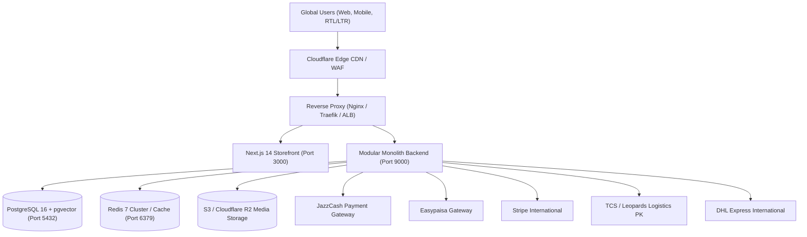

# DeBro Commerce Platform - Production Deployment & Operations Runbook

## 1. System Architecture & Topology



---

## 2. Production Deployment Procedure

### 2.1 Prerequisites
- Docker Engine `>= 24.0.0` and Docker Compose `>= 2.20.0`
- Domain DNS pointed to edge reverse proxy / Cloudflare with TLS 1.3 certs
- PostgreSQL 16 with `pgvector` extension enabled
- Production merchant account credentials for JazzCash, Easypaisa, and Stripe

### 2.2 Deployment Execution
```bash
# 1. Clone repository to deployment server
git clone git@github.com:debro/debro-platform.git /opt/debro
cd /opt/debro

# 2. Configure production secrets
cp .env.example .env.production
chmod 600 .env.production
nano .env.production

# 3. Pull images and launch stack with zero-downtime healthchecks
docker compose -f docker/docker-compose.prod.yml --env-file .env.production up -d --build

# 4. Verify container health status
docker compose -f docker/docker-compose.prod.yml ps
```

---

## 3. Live Payment Gateway Certification Checklist

| Gateway | Production Environment Variables | Verification Test | Production Requirement |
|---|---|---|---|
| **JazzCash** | `JAZZCASH_MERCHANT_ID`<br>`JAZZCASH_PASSWORD`<br>`JAZZCASH_INTEGRITY_SALT` | Execute PKR 10 live test transaction; verify HMAC-SHA256 signature and webhook callback | Live Merchant Account approval from Mobilink Microfinance Bank |
| **Easypaisa** | `EASYPAISA_STORE_ID`<br>`EASYPAISA_HASH_KEY` | Test 3DS redirect, order reference verification, and transaction query API | IP whitelisting on Telenor Microfinance Bank production firewall |
| **Stripe** | `STRIPE_SECRET_KEY`<br>`STRIPE_WEBHOOK_SECRET` | Process USD 1.00 card payment; verify 3D Secure challenge and automatic settlement | Verified corporate bank account with international payout support |
| **Cash on Delivery (COD)** | `COD_MAX_LIMIT_PKR=50000` | Place order over Rs. 50,000; ensure mandatory phone verification flag is triggered | Call-center verification workflow operational |

---

## 4. International Logistics & Shipping Configuration

- **Domestic Pakistan:**
  - Carrier: TCS Express & Leopards Courier API.
  - Tracking sync: Automated polling every 2 hours via courier tracking webhook.
  - Rates: Free shipping for orders $\ge$ Rs. 2,999 PKR; flat Rs. 250 fee below threshold.
- **International Middle East & Global:**
  - Carrier: DHL Express & FedEx Cross-Border.
  - Customs Declarations: Automated commercial invoice generation with HS Tariff codes (e.g. `8471.30.00` for computing, `6205.20.00` for cotton apparel).

---

## 5. Database Backup & Disaster Recovery Drill

### 5.1 Automated Nightly Backup Script
```bash
#!/bin/bash
set -e
TIMESTAMP=$(date +%Y%m%d_%H%M%S)
BACKUP_DIR="/var/backups/debro"
mkdir -p "$BACKUP_DIR"

# PostgreSQL physical dump
docker exec debro_prod_postgres pg_dump -U debro_admin -F c -b -v -f "/tmp/debro_${TIMESTAMP}.dump" debro_commerce_prod
docker cp debro_prod_postgres:"/tmp/debro_${TIMESTAMP}.dump" "$BACKUP_DIR/"
docker exec debro_prod_postgres rm "/tmp/debro_${TIMESTAMP}.dump"

# Upload to isolated secondary S3 / off-site cold storage
aws s3 cp "$BACKUP_DIR/debro_${TIMESTAMP}.dump" s3://debro-database-backups-cold/ --storage-class GLACIER

# Retain local backups for 14 days
find "$BACKUP_DIR" -type f -mtime +14 -delete
```

### 5.2 Restoration Procedure
```bash
# Restore from encrypted backup dump
docker exec -i debro_prod_postgres pg_restore -U debro_admin -d debro_commerce_prod -v < /var/backups/debro/debro_TIMESTAMP.dump
```

---

## 6. Telemetry, Monitoring & Alerting

- **Application Performance Monitoring (APM):**
  - Traces all request transactions across catalog, cart, checkout, and AI search modules.
  - Sentry configured for real-time unhandled exception tracking.
- **Health Probes:**
  - Liveness probe: `GET /health` (validates HTTP server event loop and uptime).
  - Readiness probe: `GET /ready` (validates PostgreSQL connection pool, Redis cache ping, and inventory service).
- **Alert Escalation Matrix:**
  - P1 (Critical Outage): Payment gateway failures $> 5\%$ or database pool exhaustion ➔ PagerDuty immediate on-call notification.
  - P2 (Warning): High API response latency (p95 $> 500$ ms) ➔ Slack `#dev-alerts` channel.
